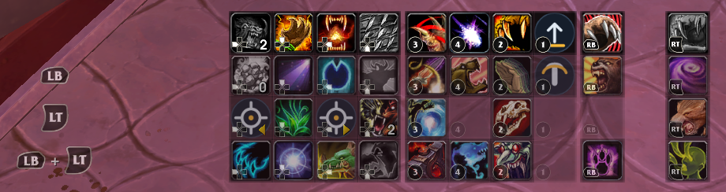
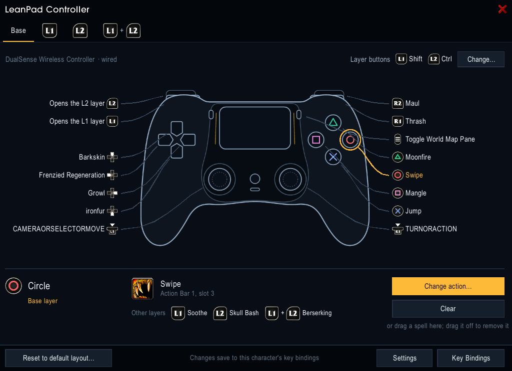
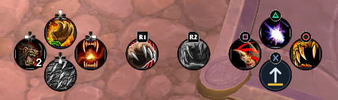
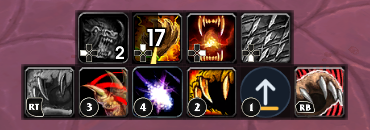
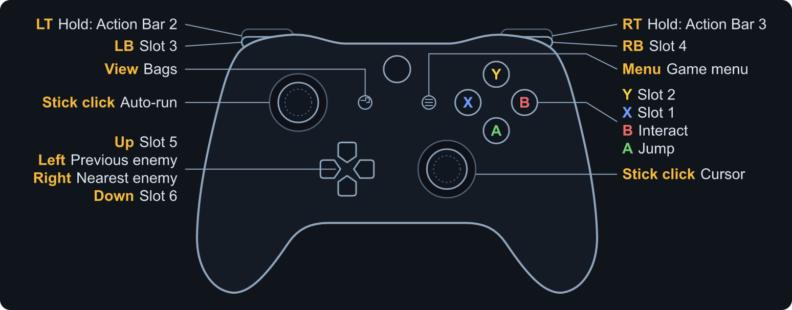

# LeanPad

Play World of Warcraft with an Xbox or PlayStation controller, on Blizzard's own action bars. For retail (Midnight, 12.1.5) and WoW: Forever (1.60.1).

[CurseForge](https://www.curseforge.com/projects/1759710) · [Latest release](https://github.com/tamuir/LeanPad/releases/latest) · [Changelog](https://github.com/tamuir/LeanPad/blob/main/CHANGELOG.md) · [Report a bug](https://github.com/tamuir/LeanPad/issues)

Controller buttons are ordinary key bindings in WoW, and LeanPad sets them to fire Blizzard's bar slots. Your layout keeps working if you turn the addon off, and it works with Blizzard's bars, ElvUI or any other bar addon. LeanPad bundles no libraries, runs nothing while you're idle and never changes a binding in combat.

## Install

Turn off ConsolePort first if you use it. Both addons write the gamepad bindings and will overwrite each other.

1. Install LeanPad from [CurseForge](https://www.curseforge.com/projects/1759710). Or download the [latest release](https://github.com/tamuir/LeanPad/releases/latest) and unzip the `LeanPad` folder into `World of Warcraft\_retail_\Interface\AddOns\`, or `_forever_` for WoW: Forever.
2. Connect a controller that WoW's gamepad support recognises, and log in.
3. Answer LeanPad's setup prompt. If buttons are already bound, it asks whether to keep your layout or use [LeanPad's](#default-layout).
4. Type `/lp` to see what every button does.

Switching to LeanPad's layout clears your controller bindings, but saves them first: `/lp undo` brings them back. Keyboard and mouse bindings are never touched.

**On WoW: Forever,** untick *Enable Gamepad UI* in *Options > Gameplay > Gamepad (Alpha)*. LeanPad can't do this for you, and [does less with it on](#wow-forever).

## What it does

### Layers

Hold LT, RT or both, and the D-pad and face buttons switch to Action Bar 2, 3 or 4. The layer buttons fire nothing themselves, as in FFXIV. You can choose which buttons they are.

Without one held you're on the Base layer, which is Action Bar 1. It changes with your form or stance, so a druid's Cat, Bear and Moonkin Forms each have their own buttons. The other layers stay the same in every form; a `[form:N]` macro gives you a per-form button there.

### Controller editor

`/lp` opens a drawing of your pad. Press a button to see what it does on each layer, then pick a spell or macro from your spellbook, choose a command, or drag a spell onto it. The *Base* picker sets up any form you've been in before, without shifting.

Which bar slot does a spell go to?

A button that already has a slot keeps it, and the new spell goes there. Otherwise LeanPad takes an empty slot that no pad button fires, on that layer's own bar, then on Action Bars 5-8, skipping any turned off in *Options > Gameplay > Action Bars*. It doesn't overwrite a spell to make room. If everything is full, the editor says so: empty a slot, or choose one yourself under *Change action > Bar slots*.

### Crossbar

  
  

Seven on-screen layouts of your controller buttons, with cooldowns, charges, range and proc glows. Choose one under *View* in `/lp settings`, then unlock it to drag the whole bar, one set or one button. Scroll over a set to resize it. You can also skip the crossbar and place Blizzard's bars in Edit Mode.

### Quests, dialogue and pop-ups

LeanPad's own window shows the NPC in 3D beside their words, and rewards as tiles with their tooltips. The same buttons answer Blizzard's pop-ups, the dungeon queue and ready checks. This is on by default on Forever and off on retail; turn it on under *Dialogue* in `/lp settings`.

How it behaves

- A quest with several rewards won't complete until you pick one.
- PvP quests, and quests that cost gold, take a second press of A.
- In combat, new conversations open in Blizzard's windows and pop-ups wait for the cursor, so the pad stays on your abilities.
- The window has nine positions, and you can set its size, text size, 3D NPC and an optional camera zoom.

### Party targeting

Hold a button and push a direction to target a party member, on the right stick or the D-pad. A ring names who is where. It needs a third layer button, which is unset by default:

1. In `/lp settings`, choose a button for *Layer 3, acts as Alt*.
2. Set *Party targeting* to the right stick or D-pad.

### Play styles and profiles

A play style sets how your character moves in combat. Tanks face the camera so they never show the pack their back, melee and ranged spin round to run when you pull straight back, and healers run freely with friendly targeting. *Auto* follows your spec, though on Forever tanks and healers should pick by hand.

A profile saves everything: settings, bindings, controller options and bar slots. Link one to each spec and LeanPad switches when you respec. A profile you aren't using stays as saved, so it doubles as a backup.

## Default layout

Slots are on Action Bar 1. On a PlayStation pad, A, B, X and Y are Cross, Circle, Square and Triangle, and LB, LT, RB and RT are L1, L2, R1 and R2.

| Button | On its own | With LT | With RT | With LT + RT |
| --- | --- | --- | --- | --- |
| D-pad up | Slot 5 | Bar 2, slot 1 | Bar 3, slot 1 | Bar 4, slot 1 |
| D-pad right | Nearest enemy | Bar 2, slot 2 | Bar 3, slot 2 | Bar 4, slot 2 |
| D-pad down | Slot 6 | Bar 2, slot 3 | Bar 3, slot 3 | Bar 4, slot 3 |
| D-pad left | Previous enemy | Bar 2, slot 4 | Bar 3, slot 4 | Bar 4, slot 4 |
| Y | Slot 2 | Bar 2, slot 5 | Bar 3, slot 5 | Bar 4, slot 5 |
| B | Interact | Bar 2, slot 6 | Bar 3, slot 6 | Bar 4, slot 6 |
| A | Jump | Bar 2, slot 7 | Bar 3, slot 7 | Bar 4, slot 7 |
| X | Slot 1 | Bar 2, slot 8 | Bar 3, slot 8 | Bar 4, slot 8 |
| LB, RB | Slots 3, 4 | | | |
| Left stick click | Auto-run | | | |
| Right stick click | Gamepad cursor | | | |
| View | Bags | World map | Character | |
| Menu | Game menu | Spellbook | | |

## How do I…

These use the default layout. The NPC and pop-up rows need the *Dialogue* settings on.

| To | Press |
| --- | --- |
| Talk, loot, or open a door or chest | B, on the nearest one |
| Click something on screen | Right stick click for the cursor, then A or B for left or right click. Click the stick again to hide it |
| Close everything that's open, like Esc | Menu. Press it again for the game menu |
| Answer an NPC or a quest | A to select or accept, B to leave or decline, the D-pad to choose, LB and RB to scroll |
| Pick a quest reward | D-pad to it, then A |
| Answer a pop-up, the dungeon queue or a ready check | A, B, X and Y press its buttons from left to right |
| Release your spirit | A. Recap is on B |
| Change a button | `/lp`, press the button, then *Change action*. Hold a layer button first for its layer |
| Go back to the layout before the last reset | `/lp undo` |
| Go back to the controls from before LeanPad | `/lp restore`. It doesn't reset play style settings |

## WoW: Forever

Forever has its own controller interface, Blizzard's Gamepad UI, which replaces the action bars. LeanPad works with it on or off, but does more with it off. If it's on when you log in, LeanPad reminds you, then offers its layout once you've unticked it. Press B on the reminder to keep it on and not be asked again.

| | Gamepad UI off | Gamepad UI on |
| --- | --- | --- |
| Spells on A, B, X and Y on the Base layer | Yes | No, Blizzard keeps those four |
| Spells on the bumpers, stick clicks, View and Menu | Yes | No, commands only |
| Commands such as map or bags on the LT and RT layers | Yes | No, spells and macros only |
| Clicking the crossbar with the mouse | Every view | The Base layer only in views that swap as you hold a layer button |
| Answering quests with the pad | LeanPad's dialogue window | Blizzard's own |
| Blizzard's radial menus, controller menu navigation and group targeting | No, use the cursor for windows | Yes |

With the Gamepad UI on, the Base, LT, RT and LT + RT layers are Blizzard's top, left, right and bottom gamepad bars, and LeanPad's crossbar stands in for them. Settings and profiles are separate from retail's.

## Commands

| Command | What it does |
| --- | --- |
| `/lp` | Open or close the controller editor |
| `/lp settings` | Open the settings |
| `/lp profile <name>` | Switch to a profile |
| `/lp party ring`, `dpad` or `off` | Party targeting on the right stick or D-pad, or off |
| `/lp undo` | Bring back the layout from before the last reset |
| `/lp restore` | Bring back the controls from before LeanPad |
| `/lp perf` | Print LeanPad's CPU cost |

## Something not working?

| Problem | Try |
| --- | --- |
| The controller does nothing | Tick *Gamepad input* in `/lp settings`. On Forever, check the [Gamepad UI](#wow-forever) |
| Buttons keep changing back | Turn off ConsolePort or any other gamepad addon |
| A pop-up says your bindings changed | You switched between account and character key bindings, reset them, or another addon changed them. Put yours back or keep the new ones |
| The wrong button names show | Set *Button labels* in `/lp settings` |
| A layer's spells aren't on screen | Turn on Action Bars 2-4 in *Options > Gameplay > Action Bars*, or use the crossbar |
| Blizzard's quest window opens instead | Turn on LeanPad's under *Dialogue* in `/lp settings`. In combat it's always Blizzard's |

Still stuck? [Open an issue](https://github.com/tamuir/LeanPad/issues) with your LeanPad version, controller, bar addon and any Lua error.

## Contributing

Tests, ground rules and releasing are in [CONTRIBUTING.md](https://github.com/tamuir/LeanPad/blob/main/CONTRIBUTING.md). LeanPad is licensed under the GNU GPL, [version 2 or later](https://github.com/tamuir/LeanPad/blob/main/LICENSE).
